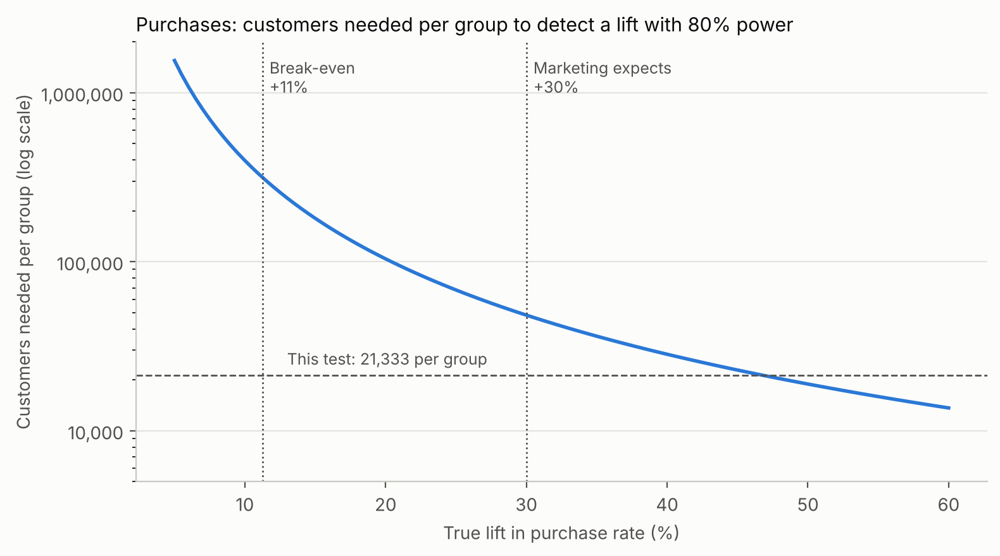
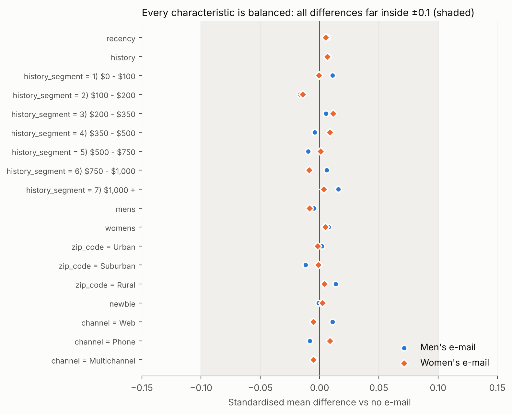
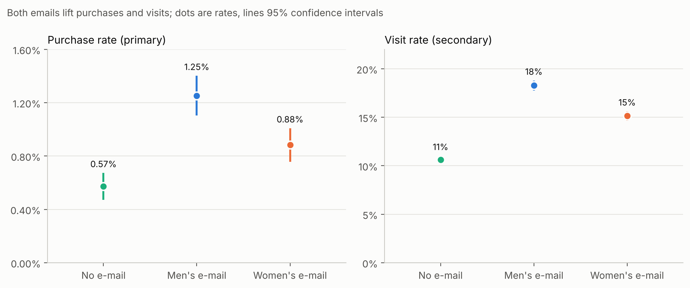
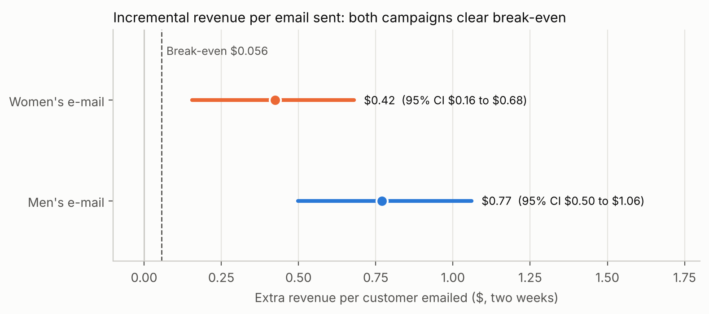
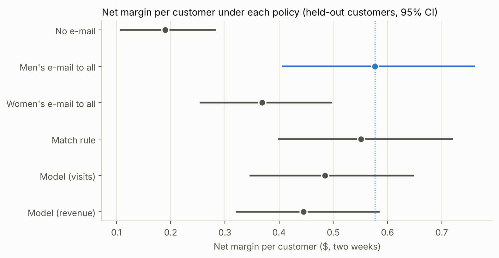
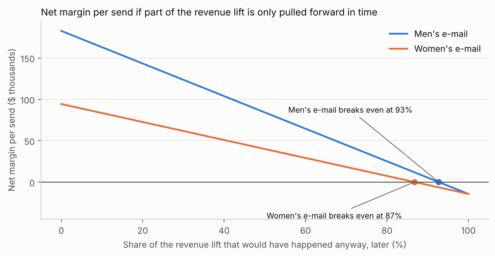
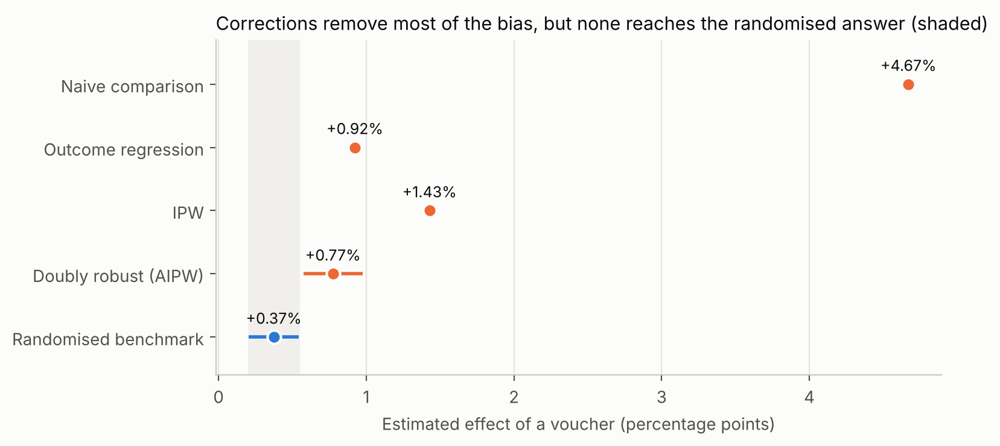
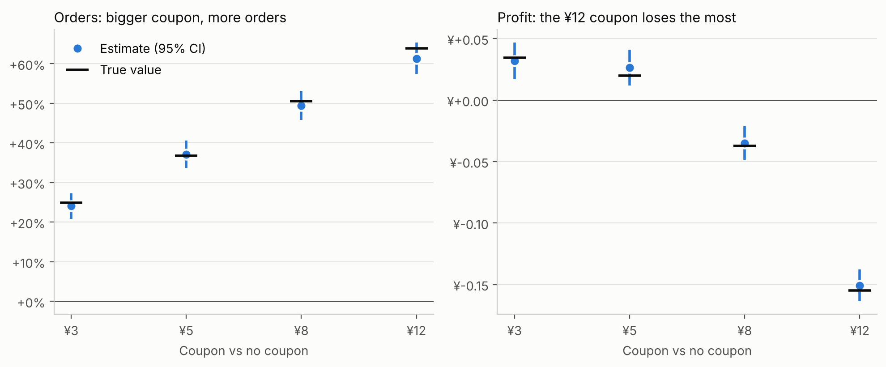
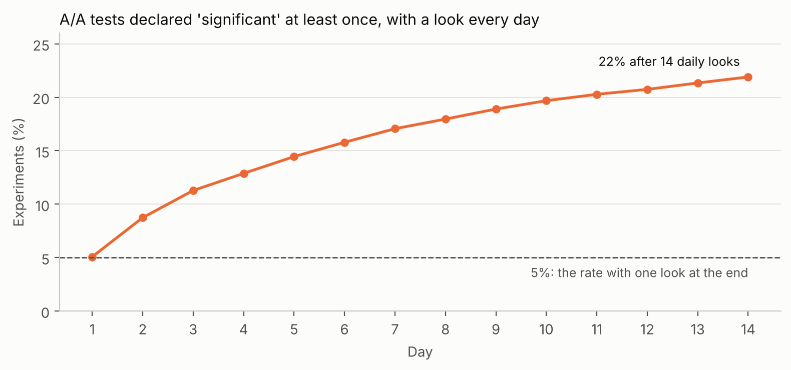

# Does email cause sales? An A/B testing case study

*Nathan Chen*

This is the full story of one experiment, told the way it would unfold inside a company: from a sceptical CFO's question to a recommendation with money attached. It is written to be read top to bottom in about 15 minutes. Every chapter ends with links to the analysis (Jupyter notebooks) and to the company documents a data scientist would actually produce at that stage.

> **What is real and what is not.** The data and every result are real: a randomised email experiment with 64,000 customers, released by Kevin Hillstrom in 2008. The company's people, messages and business figures (margins, costs, file size) are an invented scenario, used to show how the analysis connects to decisions.

**Contents**

1. [The problem](#1-the-problem)
2. [Designing the test](#2-designing-the-test)
3. [Checking the data](#3-checking-the-data)
4. [Results](#4-results)
5. [Who should get which email?](#5-who-should-get-which-email)
6. [The recommendation](#6-the-recommendation)

- [Extension A: What goes wrong without randomisation](#extension-a-what-goes-wrong-without-randomisation)
- [Extension B: A coupon test with five arms, and the danger of peeking](#extension-b-a-coupon-test-with-five-arms-and-the-danger-of-peeking)
- [Why this dataset](#why-this-dataset) · [Glossary](#glossary)

---

## 1. The problem

**In one line: the CFO doesn't believe the email report, and he is right not to.**

A US apparel retailer sells through its website and a phone line for catalogue customers. Marketing has two new email campaigns, one featuring men's merchandise and one featuring women's, and wants to send them to all 640,000 active customers, twice a month.

The CFO won't approve the budget (about $192,000 a year in creative) yet. The weekly email report credits email with $1.2M of revenue last quarter, but it counts **every purchase by anyone who received an email**. These are the company's most recent customers; many would have bought anyway. His question is the central question of marketing measurement:

> *How much revenue did the email **cause**, not just precede?*

The only way to answer it is a **holdout**: a randomly chosen group that gets no email. Comparing them with the emailed customers isolates what the email itself did.

In the kickoff meeting the data scientist turns the request into something testable: what decision depends on the result (keep the programme or cut it; which campaign to scale), what a sale is worth (a $100 average order at 40% gross margin), and the constraints. The biggest constraint: only **64,000 customers** (10% of the file) are available, because the rest are in a separate catalogue test running at the same time.

**Go deeper:** [the request](docs/company_documents/ch1a_request.md) · [kickoff notes](docs/company_documents/ch1b_kickoff_notes.md)

---

## 2. Designing the test

**In one line: a campaign pays for itself at +11% more purchases, but this test can only reliably see +47%, so we agree in advance what an inconclusive result means.**

Before anything is sent, the design is written down and signed off. That matters because choosing metrics *after* seeing results makes it easy to find something that "worked".

**The setup.** Three groups of about 21,333 customers each, assigned at random: no email, men's email, women's email. Behaviour is measured for the two weeks after the send, closing just before the next campaign.

**The metrics.** Revenue per customer breaks down into a chain: *visit rate × purchase rate among visitors × spend per buyer*. The email mainly acts on the first link (bringing people back), so visits are the most sensitive metric, but Finance's decision depends on money. The design makes **purchase rate the primary metric**, the one the decision rests on, with visits and revenue as secondary metrics. Unsubscribes would be the guardrail metric but aren't in the data, which is noted as a limitation.

**What is a success worth?** Each email costs $0.01 to send plus its share of the $8,000 creative cost, $0.0225 in total. At a 40% margin it needs **$0.056 of extra revenue per email** to break even, which is about **+11% more purchases**.

**What can the test detect?** With 21,333 customers per group, the smallest lift the test detects 80% of the time (the *minimum detectable effect*) is about +9% for visits, but **+47% for purchases** and +57% for revenue. Purchases are rare (about 1 in 200 customers in two weeks), so they are hard to measure precisely.

That gap, between what matters (+11%) and what we can see (+47%), is the most important fact in the design. Detecting the break-even lift would need over 300,000 customers per group, more than the whole active file. Even at the +30% Marketing expects, the test has only a 42% chance of a clear result.

So the design states, before launch, that **a non-significant result on purchases means "inconclusive", not "no effect"**, and Finance signs off on that. It also argues for an **equal three-way split**: shrinking the holdout to 10% would save only about $900 of margin while cutting the chance of detecting a +30% lift from 42% to 17%.

**Go deeper:** [design doc](docs/company_documents/ch2_experiment_design_doc.md) · [notebook: the numbers behind the design](notebooks/ch2_experiment_design.ipynb)

---

## 3. Checking the data

**In one line: the randomisation worked, and two measurement gaps mean the results will understate the true effect.**

When the data arrives, nobody looks at results until two questions are answered: is the data correct, and did the random assignment work?

**The random split worked.** Group sizes are 21,306, 21,307 and 21,387, exactly what random thirds should produce (p = 0.90). The groups are also alike on everything measured *before* the email: recency, past spend, channel, location, new-customer status. The largest difference on any characteristic is 0.016 standard deviations, against a usual threshold of 0.1.

**Four data findings**, each with a decision:

| Finding | What it means | Decision |
|---|---|---|
| A zip-code label is misspelled ("Surburban") | Cosmetic | Fixed |
| 6,562 identical rows | Almost all are customers with exactly $29.99 of past spend and no activity: identical customers, not duplicates | Kept; customer IDs requested for future extracts |
| **Every purchase comes with a website visit**, though 44% of customers order by phone | Phone orders are probably missing, so only **online** purchases are measured | Results will understate the total effect |
| **Spend tops out at exactly $499** | Large orders appear to be capped | Revenue effects will be conservative |

One more lesson from this step: when you test eight characteristics, the chance that one of them looks "significantly" unbalanced by pure luck is high. In a placebo exercise with randomly shuffled groups it happened 27% of the time. So the go/no-go decision rests on the *size* of differences and on one joint test, not on any single p-value.

**Decision: go.** Results may be read as planned.

**Go deeper:** [validation report](docs/company_documents/ch3_validation_report.md) · [notebook: data and randomisation checks](notebooks/ch3_data_checks.ipynb)

---

## 4. Results

**In one line: both emails cause extra purchases and pay for themselves many times over; the men's email wins.**

**Purchases (the primary metric).** Without email, 0.57% of customers bought in the two weeks. With the men's email, 1.25% did (**+119%**, 95% confidence interval +77% to +171%); with the women's email, 0.88% (**+54%**, interval +23% to +94%). Both pass the pre-registered test, with a correction for making two comparisons. Visits rose too: +72% and +43%.

**Revenue (the business case).** Revenue per customer is a difficult metric: over 99% of customers spend nothing, and buyers vary hugely. The analysis therefore checks the usual confidence interval against a *bootstrap* (resampling customers thousands of times), and the two agree. The men's email adds **$0.77 per customer** and the women's **$0.42**, against the $0.056 break-even.

That is about 14× the break-even for the men's email and 7.5× for the women's, and even the low ends of the confidence intervals are well above it (about 9× and 3×). The men's email beats the women's by $0.35 per email (interval $0.05 to $0.66), so under the pre-agreed rule it is the winner.

**Three traps avoided along the way:**

- **"Purchases per visitor."** Emailed visitors bought more often than holdout visitors, but that comparison is misleading. The email changes *who* visits, so the visitors in each group are different people. Decisions use metrics computed over **all customers in each group**.
- **The Mann-Whitney test.** It is popular for skewed data, but with 99% zeros it mostly tests *how many* people bought, not *how much revenue* came in. Finance's question is about the mean.
- **Spend per buyer.** It barely changed ($114 with or without the men's email). The revenue lift comes from more buyers, not bigger baskets.

**A lesson for next time.** The plan also included a *regression-adjusted* estimate, which uses customer characteristics to sharpen precision, an industry-standard technique (often called CUPED). Here it added less than 3% precision, because last year's totals barely predict a two-week purchase. What would help is each customer's visits and purchases in the comparable period *before* the send. A pre-period metric with a correlation of 0.5 is worth a third more customers at no cost, so it goes into the recommendations.

**Go deeper:** [results readout](docs/company_documents/ch4_results_readout.md) · notebooks: [purchases and visits](notebooks/ch4a_purchases_and_visits.ipynb), [revenue and the business case](notebooks/ch4b_revenue.ipynb), [variance reduction](notebooks/ch4c_variance_reduction.ipynb)

---

## 5. Who should get which email?

**In one line: send the men's email to everyone; no targeting rule or model did better.**

Marketing's third question was about targeting. The design classed this as **exploratory**: patterns found here are hypotheses for a future test, not confirmed results.

**Slicing by segment mostly finds noise.** Cutting the revenue lift by 18 customer segments gives 36 comparisons, and a few look striking, such as the women's email showing *negative* effects among mid-value customers. With so many comparisons and such wide intervals, some extreme results are expected by chance, and there is no business reason behind them. They were not used.

**One pattern with a reason holds up.** The emails feature men's or women's merchandise, and we know what each customer bought last year. Testing that single hypothesis:

| Bought last year | Men's email: extra visits | Women's email: extra visits |
|---|---|---|
| Men's merchandise only | +6.9 points | **+1.1 points** |
| Women's merchandise only | +7.1 points | +7.4 points |

The women's email barely moves men's-only buyers; the men's email works for everyone. Even for women's buyers the two emails perform about the same.

**Uplift models** are machine-learning models that predict, for each customer, how much the email changes their behaviour. They worked for visits, but only slightly better than a one-line rule ("women's buyers first"). For revenue, with only 578 buyers in total, their performance swung from worse than random to better than random depending on how the data was split.

**Comparing targeting policies.** Because assignment was random, we can estimate what any targeting policy would have earned without running it (a technique called *inverse propensity weighting*). On customers the models never saw during training:

"Men's email to everyone" earns as much as anything else. With an email costing about two cents, excluding anyone loses money, and the model-based policies earned less. That is a common and valuable finding: **before investing in a targeting model, check whether it beats sending the best treatment to everyone.**

**Go deeper:** [targeting analysis](docs/company_documents/ch5_targeting_analysis.md) · [notebook: targeting](notebooks/ch5_targeting.ipynb)

---

## 6. The recommendation

**In one line: approve the programme, roll out the men's email, and keep a small long-term holdout to keep measuring.**

Sent to the full active file, the men's email would add about **$183,000 of net margin per send** after creative and sending costs (plausible range $113,000 to $257,000).

The two-week test cannot measure everything. Some extra purchases might only have been *pulled forward* from later weeks, and the margin figure is Finance's estimate. A break-even analysis shows how wrong those assumptions would have to be to change the decision:

The men's email stays profitable unless more than **93%** of its extra sales were merely pulled forward, or future campaigns achieve less than 7% of this effect. That margin of safety makes the decision easy.

**Next steps, each with a size:**

| Next step | Size | Why |
|---|---|---|
| Long-term holdout: 5% of customers get no campaigns for a quarter | 32,000 customers; about $9,000 of margin per send | Measures the programme's effect over time, net of pull-forward and email fatigue |
| Test new creative against the men's email, with **visits** as the primary metric | About 24,000 per group for a 1-point difference | Detecting a $0.10 revenue difference would need about 355,000 per group |
| Data fixes: phone orders, pre-period behaviour, customer IDs, unsubscribes | No cost | Complete measurement and more precision per test |

Note how the second test flips the metric choice made in chapter 2. When both groups receive an email, the creative's job is to bring people in, and visits can measure that precisely. **The metric follows the decision.**

**Go deeper:** [decision memo](docs/company_documents/ch6_decision_memo.md) · [notebook: the numbers behind the memo](notebooks/ch6_recommendation.ipynb)

---

## Extension A: What goes wrong without randomisation

**In one line: estimated from targeted data, a voucher's effect looked 13 times bigger than it really was, and statistical corrections could not fully fix it.**

Most companies don't have a holdout. They estimate promotion effects from data where a targeting system decided who got the promotion. Lazada (Alibaba Group) released a rare dataset that shows how badly that can go: the same voucher, once **assigned by its targeting system** (926,669 customers) and once **assigned at random** (181,669 customers). The outcome is anonymised, which doesn't matter here: the only question is whether a method recovers the randomised answer.

- **The randomised answer:** vouchers raise the outcome by **+0.37 percentage points (+11%)**.
- **The naive answer from targeted data: +4.72 points**, a six-fold increase and 13× the truth. The targeting system picked customers who were likely to buy anyway.

Three standard corrections, all using the 83 customer features:

They remove most of the bias, but none reaches the truth, and the most sophisticated one (*doubly robust* estimation) produces a narrow confidence interval that doesn't contain it: **false precision**. The reasons can't be fixed with more modelling. Targeting was so predictable that half the customers had almost no chance of being in the other group, any targeting reason not captured in the data stays hidden, and the two files describe different customer populations.

**The lesson for the main case:** this is why the email experiment's holdout, and the long-term holdout in the recommendation, are worth their cost.

**Go deeper:** [notebook: selection bias with Lazada data](notebooks/extA_selection_bias.ipynb)

---

## Extension B: A coupon test with five arms, and the danger of peeking

**In one line: the coupon that maximises orders loses the most money, and checking results daily turns 5% false alarms into 22%.**

Modern experiments often look different from the email case: a food-delivery app tests several coupon levels at once, outcomes run through a funnel (see the offer, click, order), and every coupon costs money. No public dataset of that kind has defined metrics and costs, so this extension uses a **simulation** with a known truth, loosely modelled on large-scale coupon tests such as Meituan's MT-LIFT. Because the true effects are known, every method can be checked against them.

**Five arms, one million users** (no coupon, ¥3, ¥5, ¥8, ¥12):

- **Bigger coupons always bring more orders, but the ¥12 coupon loses the most money**, because coupons are paid on every order, including orders that would have happened anyway. The right primary metric is profit, not orders.
- **Orders per click fall as coupons grow**, while orders per user rise: coupons attract extra, less committed clickers. This is the same trap as purchases per visitor in chapter 4.
- **Targeting pays when treatments are expensive.** A simple rule (¥5 only for users who redeemed coupons before) beats every blanket coupon and captures about 80% of the best possible gain. An uplift model trained on profit does worse than a blanket ¥3.

**Peeking.** Simulating 10,000 experiments with no real effect, and checking each one daily for 14 days:

Stopping at the first p < 0.05 declares a winner in **22%** of experiments that have no effect at all. A **sequential design** (O'Brien–Fleming boundaries, strict early and lenient late) allows daily looks while keeping false positives at about 5%, and still detects a real +5% effect 94% of the time, usually stopping by day 9 instead of 14. Swapping p-values for a Bayesian "probability of being better" and stopping at 95% gives 19% false winners: the same problem in different clothes.

**Go deeper:** notebooks: [five-arm coupon experiment](notebooks/extB1_coupon_experiment.ipynb), [monitoring and peeking](notebooks/extB2_monitoring.ipynb)

---

## Why this dataset

Before choosing, I compared the public datasets most used for A/B testing and uplift modelling against what a business case needs:

| Dataset | Business context stated | Metrics defined | Randomised | Has money |
|---|---|---|---|---|
| **Hillstrom** (2008, US retailer, email) | Yes | Yes: visit, purchase, spend | Yes | Yes |
| X5 RetailHero (2019, Russian grocer) | Partly | "A purchase afterward", no time window | Not stated | Pre-period only |
| Lazada (2022, Alibaba) | Partly (vouchers) | No: an undefined `label` | Test set only | No |
| MT-LIFT (2024, Meituan) | Partly (coupons) | Click, conversion | Disputed | No; downloads no longer available |
| ASOS (2021, fashion) | Partly | No: "Metric 1–4" | Yes | Unknown |
| Kaggle tutorial datasets | Usually none | Varies | Unknown | Often synthetic |

Companies strip exactly what makes data a business case: what the treatment was, what the outcome means, and anything involving money. Hillstrom is the only public dataset where every step of a business A/B test can be done honestly; its age changes nothing about the methods. The extensions use the other sources only for what they do well: Lazada for selection bias, and a simulation where the truth is known.

---

## Glossary

| Term | Meaning |
|---|---|
| **Holdout / control group** | Customers randomly chosen to receive nothing, so their behaviour shows what would have happened anyway |
| **Incremental** | Caused by the treatment, over and above what would have happened without it |
| **Primary metric** | The single metric the decision rests on, chosen before the experiment |
| **Guardrail metric** | A metric that must not get worse (such as unsubscribes) |
| **Pre-registration** | Writing down metrics, analysis and decision rules before seeing results |
| **Minimum detectable effect (MDE)** | The smallest true effect a test detects with high probability (here 80%) |
| **Power** | The probability that a test detects an effect of a given size |
| **Break-even lift** | The effect size at which the treatment exactly pays for its cost |
| **Confidence interval** | The range of effect sizes consistent with the data (95%: the method captures the true value 95% of the time) |
| **Holm correction** | An adjustment that keeps the false-positive rate at 5% when making several comparisons |
| **Sample-ratio mismatch (SRM)** | Group sizes that differ from the planned split, a sign that assignment or logging broke |
| **Standardised mean difference (SMD)** | The difference between groups in standard-deviation units, used to judge balance |
| **Bootstrap** | Estimating uncertainty by resampling the data many times |
| **Regression adjustment / CUPED** | Using characteristics measured before the experiment to make estimates more precise |
| **Uplift model** | A model predicting how much a treatment changes each individual's outcome |
| **Qini curve** | A chart showing how well a ranking of customers puts the most responsive first |
| **Inverse propensity weighting (IPW)** | Reweighting customers by their chance of getting the treatment they got, to evaluate policies or correct for targeting |
| **Doubly robust (AIPW)** | A correction combining an outcome model and IPW |
| **Sequential testing** | A design that allows repeated looks at the data while controlling false positives |
| **A/A test** | An experiment where both groups get the same thing, used to check the system |
