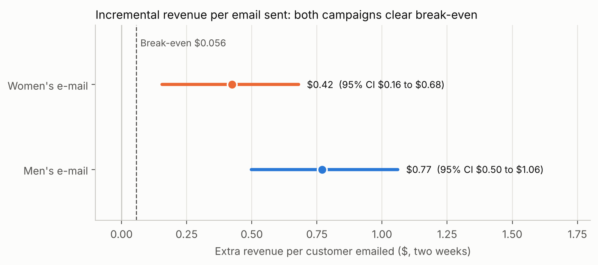

# Does email cause sales?

**An end-to-end A/B testing case study:** a randomised email experiment with 64,000 customers, taken from a CFO's sceptical question to a recommendation with money attached.

`Python` · `experiment design` · `power analysis` · `causal inference` · `uplift modelling` · `sequential testing`

---

## The question

A retailer's email report credits campaigns with $1.2M of revenue a quarter, but it counts every purchase by anyone who got an email. The CFO's question: **how much of that did the email actually *cause*?** Answering it takes a randomised experiment with a holdout group that gets no email.

## The answer

- **Both emails cause extra purchases.** The men's email more than doubled the purchase rate (**+119%**); the women's raised it by half (**+54%**).
- **They pay for themselves many times over.** The men's email adds **$0.77 of revenue per email** against a break-even of $0.056, about **$183,000 of net margin per send** to the full customer file.
- **Send the men's email to everyone.** It wins overall, and no targeting rule or machine-learning model did better.



## The case at a glance

**[Read the full case study →](CASE_STUDY.md)** (about 15 minutes, plain language, with charts)

| Chapter | The question at this stage | What I found |
|---|---|---|
| [1. The problem](CASE_STUDY.md#1-the-problem) | What decision depends on this test? | Only a holdout can separate caused sales from sales that would have happened anyway |
| [2. Designing the test](CASE_STUDY.md#2-designing-the-test) | What lift is worth having, and can the test see it? | Break-even is +11% purchases, but the test can only reliably detect +47%, so "not significant" was pre-defined as inconclusive |
| [3. Checking the data](CASE_STUDY.md#3-checking-the-data) | Can we trust the data and the randomisation? | Randomisation worked; only online purchases are recorded and spend is capped, so results are conservative |
| [4. Results](CASE_STUDY.md#4-results) | Did the emails work, and are they worth it? | Both emails clear break-even 7–14× over; the men's email wins |
| [5. Who should get which email?](CASE_STUDY.md#5-who-should-get-which-email) | Does targeting beat sending to everyone? | No: the women's email only works for women's buyers, and models don't beat a blanket send |
| [6. The recommendation](CASE_STUDY.md#6-the-recommendation) | What should the business do? | Roll out, keep a long-term holdout; the decision survives even if 93% of the lift were pulled forward |

**Two extensions** show what the main case cannot:

- **[A. Without randomisation](CASE_STUDY.md#extension-a-what-goes-wrong-without-randomisation)** (real Lazada data): a voucher's effect estimated from targeted data was **13× too large**, and statistical corrections couldn't fully fix it.
- **[B. A five-arm coupon test](CASE_STUDY.md#extension-b-a-coupon-test-with-five-arms-and-the-danger-of-peeking)** (simulation with a known truth): the coupon that maximises orders **loses the most money**, and checking results daily turns 5% false alarms into **22%**.

## What this project demonstrates

| Area | Methods |
|---|---|
| **Experiment design** | Metric trees and metric roles, pre-registration, break-even analysis, power and minimum detectable effect, holdout sizing |
| **Validation** | Sample-ratio mismatch tests, covariate balance (standardised differences, joint tests), data-quality checks |
| **Analysis** | Proportion tests, Holm and Dunnett corrections, bootstrap and delta-method intervals, regression adjustment and CUPED |
| **Causal inference and ML** | Uplift modelling (T- and S-learners, Qini curves), policy evaluation by inverse propensity weighting, IPW and doubly robust estimation |
| **Monitoring** | A/A tests, peeking simulations, O'Brien–Fleming sequential boundaries, Bayesian stopping rules |
| **Engineering** | A tested Python package (`src/expt`, 50 unit tests), reproducible pipeline (`make all`), checksum-verified data downloads |
| **Communication** | Company-style documents: design doc, validation report, results readout, decision memo |

## How to read this repo

| If you want... | Go to |
|---|---|
| The story and the results | [`CASE_STUDY.md`](CASE_STUDY.md) |
| The analysis behind each chapter | [`notebooks/`](notebooks/): `ch2_…` to `ch6_…` for the case, `extA_…` and `extB…` for the extensions |
| The documents a data scientist would write at each stage | [`docs/company_documents/`](docs/company_documents/) |
| The reusable code | [`src/expt/`](src/expt/), tested in [`tests/`](tests/) |

```
.
├── CASE_STUDY.md            # the full story, start here
├── notebooks/               # analysis, numbered by chapter
├── docs/company_documents/  # request, kickoff, design doc, validation report, readout, targeting, memo
├── src/expt/                # toolkit: power, validation, inference, uplift, policy, causal, simulate, sequential
├── tests/                   # unit tests for the toolkit
├── images/                  # charts used in this README and the case study
├── scripts/                 # data download, preparation and figure export
└── Makefile                 # make all: data, tests and every notebook
```

## Run it

```bash
python -m venv .venv && source .venv/bin/activate
pip install -r requirements.txt
make all        # downloads and verifies the data, runs the tests, executes every notebook (about 10 minutes)
```

Executed notebooks are written to `runs/`, leaving the published ones untouched. To use a specific interpreter: `make all PYTHON=/path/to/python`.

## Data and credits

- **Hillstrom** (main case): Hillstrom, K. (2008). *The MineThatData E-Mail Analytics and Data Mining Challenge.* [blog.minethatdata.com](https://blog.minethatdata.com/2008/03/minethatdata-e-mail-analytics-and-data.html). The download script only accepts a file whose SHA-256 checksum matches the original.
- **Lazada** (extension A): Zhong, K. et al. (2022). *DESCN: Deep Entire Space Cross Networks for Individual Treatment Effect Estimation.* KDD 2022. [github.com/kailiang-zhong/DESCN](https://github.com/kailiang-zhong/DESCN). Distributed by Alibaba Group under a BSD-style license.
- **Coupon simulation** (extension B): simulated in [`src/expt/simulate.py`](src/expt/simulate.py), loosely modelled on large-scale coupon tests such as Meituan's MT-LIFT.

The company, its people and its business figures (margins, costs, file size) are an invented scenario; the data and results are real. No data is committed to this repository. Code is MIT-licensed.

## Author

**Nathan Chen**
