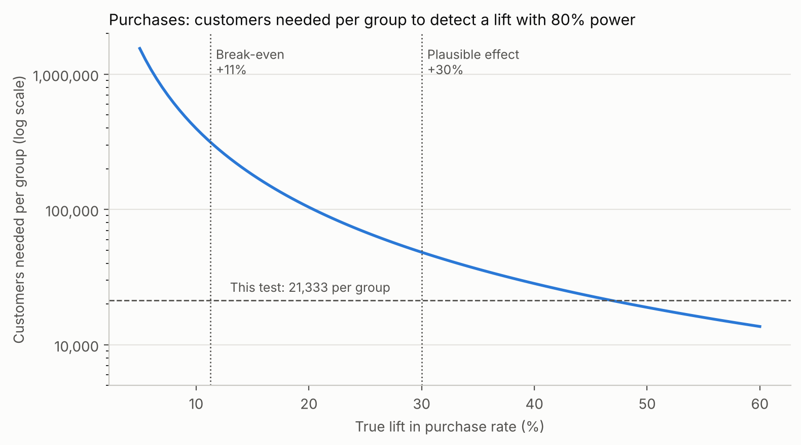
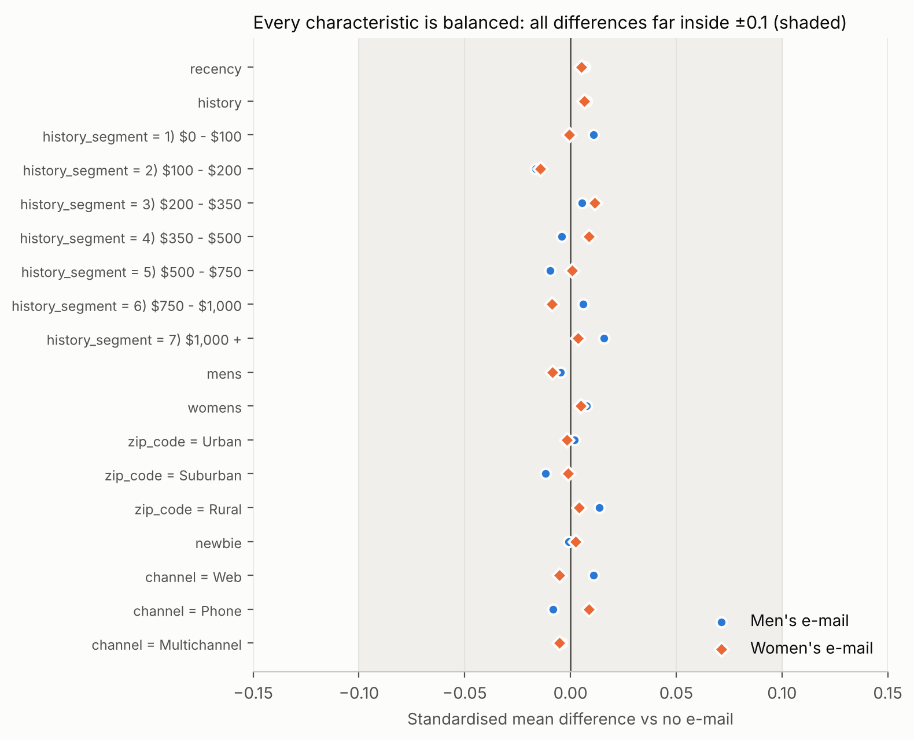
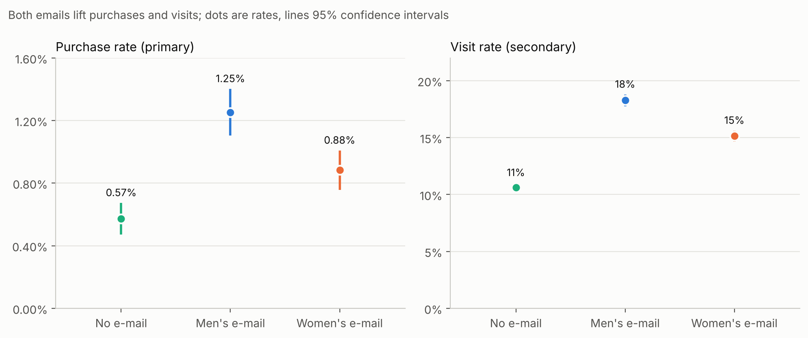
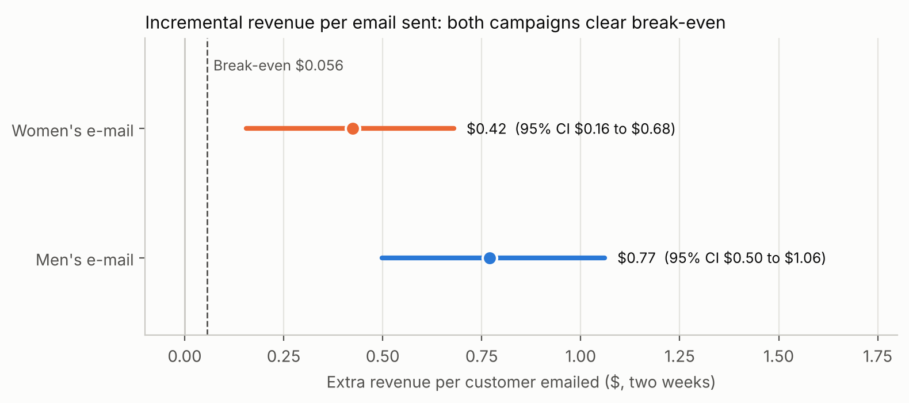
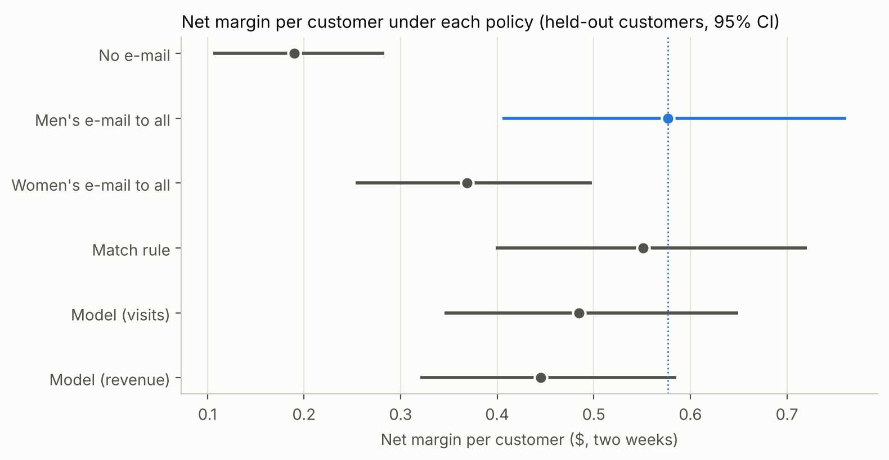
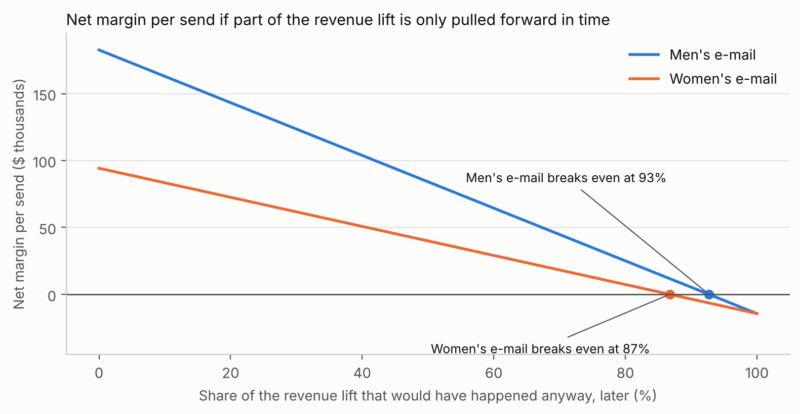
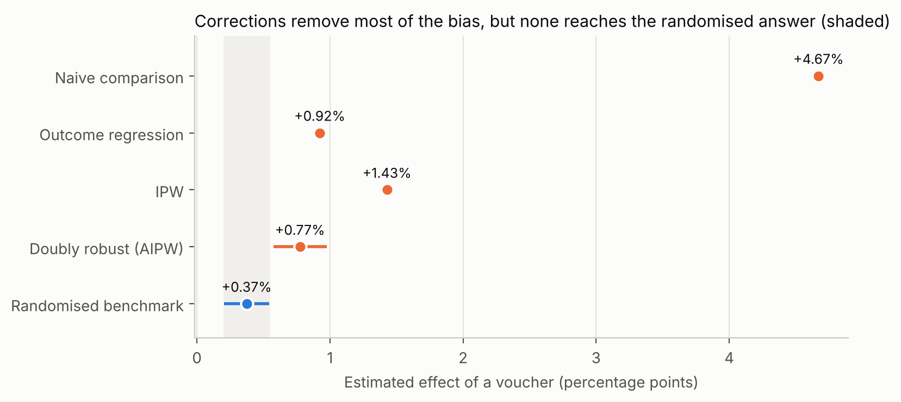
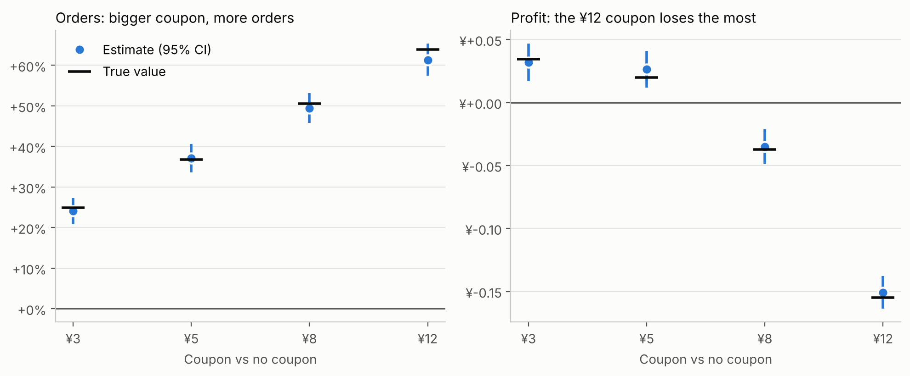
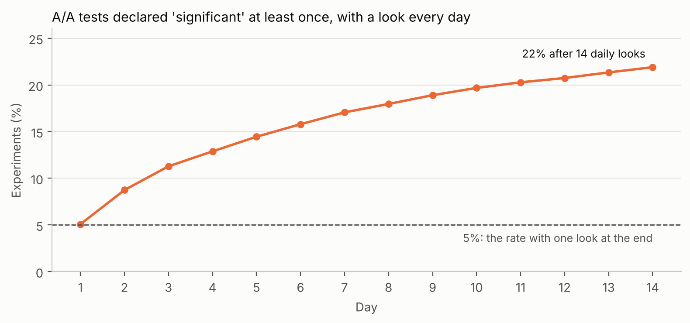

# Does email cause sales? Measuring the incremental effect of email campaigns

*Nathan Chen*

This report covers my project from the question to the recommendation, in about 15 minutes of reading. Each section links to the notebook with the analysis and to the working document I wrote at that stage.

**Contents**

[About this project](#about-this-project)

1. [The question](#1-the-question)
2. [Analysis plan](#2-analysis-plan)
3. [Data validation](#3-data-validation)
4. [Results](#4-results)
5. [Targeting](#5-targeting)
6. [Recommendation](#6-recommendation)

- [Extension A: What goes wrong without randomisation](#extension-a-what-goes-wrong-without-randomisation)
- [Extension B: A five-arm coupon test, and the danger of peeking](#extension-b-a-five-arm-coupon-test-and-the-danger-of-peeking)
- [Why I chose this dataset](#why-i-chose-this-dataset)
- [Limitations and what I would do next](#limitations-and-what-i-would-do-next)

---

## About this project

I wanted to practise A/B testing the way it is used in a business: start from a decision, define metrics before looking at results, and end with a recommendation that involves money. Most public examples stop at a p-value.

My starting point was a simple way to think about revenue: **revenue = visitors × conversion × revenue per buyer**. A successful marketing action has to move at least one of the three, so the metrics of an experiment should come from that chain. That framing shaped every metric choice below.

Finding data that supports this was the hardest part. A business test needs a stated context, defined metrics and real randomisation, and most public datasets lack at least one. I settled on the Hillstrom e-mail experiment, a randomised test with 64,000 customers ([why](#why-i-chose-this-dataset)). Because it ran in 2008, I treated it as if I were planning it: I wrote the analysis plan before looking at any outcome, then analysed the results exactly as planned.

> **What is real and what is assumed.** The data and every result are real. The dataset contains no costs or margins, so all money figures rest on business assumptions I set and state in the [project brief](docs/1_project_brief.md); the [recommendation](#6-recommendation) tests how much they matter.

---

## 1. The question

**In one line: how much revenue does an email campaign *cause*, rather than just precede?**

Email reports usually credit a campaign with every purchase by anyone who received it. For a list of recent customers that overstates the effect, because many of them would have bought anyway. The only way to measure what the email itself does is a **holdout**: customers chosen at random to receive nothing.

**The data.** A US apparel retailer that sells online and through a phone line for catalogue customers. 64,000 customers who bought in the past year were randomly split into three groups: no email, an email featuring men's merchandise, and one featuring women's. Visits, purchases and spend were recorded for the two weeks after the send.

**My questions:**

1. Does each email cause additional purchases and revenue?
2. Which email works better?
3. Is the effect large enough to pay for the campaign?
4. Should different customers receive different emails, or none?

**My business assumptions** for translating effects into money: a $100 average order, a 40% gross margin, $0.01 to send an email, $8,000 to produce each campaign, and an active file of 640,000 customers (so the test is a 10% sample of it).

**Go deeper:** [project brief](docs/1_project_brief.md)

---

## 2. Analysis plan

**In one line: a campaign pays for itself at +11% more purchases, but this test can only reliably see +47%, so I decided in advance what an inconclusive result would mean.**

I wrote the plan before looking at any outcome. Choosing metrics *after* seeing results makes it easy to find something that "worked".

**Metrics.** Following the revenue chain, the email mainly acts on the first link, bringing people back to the site, so visits are the most sensitive metric. But the question is about money, and a catchy subject line can raise visits without sales. I made **purchase rate the primary metric**, the first point in the chain that proves money moved, with visits and revenue per customer as secondary metrics. Unsubscribes would be the guardrail but aren't in the data.

**Break-even.** Each email costs $0.01 to send plus its $0.0125 share of the creative, $0.0225 in total. At a 40% margin it needs **$0.056 of extra revenue per email**, about **+11% more purchases**.

**What the test can detect.** With 21,333 customers per group, the smallest lift detected 80% of the time (the *minimum detectable effect*) is about +9% for visits, but **+47% for purchases** and +57% for revenue. Purchases are rare, about 1 in 200 customers in two weeks, so they are hard to measure precisely.

That gap, between what matters (+11%) and what the test can see (+47%), is the most important fact in the plan. Detecting the break-even lift would need over 300,000 customers per group, more than the whole file; even at a plausible +30% lift, the test has only a 42% chance of a clear result. So I fixed in advance that **a non-significant result on purchases means "inconclusive", not "no effect"**, and that the business case would be judged on revenue against break-even, with confidence intervals.

I also checked whether an equal three-way split was right. A 10% holdout would have emailed more customers during the test, gaining only about $900 of margin, while cutting the chance of detecting a +30% lift from 42% to 17%.

**Go deeper:** [analysis plan](docs/2_analysis_plan.md) · [notebook](notebooks/ch2_experiment_design.ipynb)

---

## 3. Data validation

**In one line: the randomisation worked, and two measurement gaps mean the results understate the true effect.**

Before comparing any outcome between groups, I checked two things: is the data correct, and did the random assignment work?

**The random split worked.** Group sizes are 21,306, 21,307 and 21,387, what random thirds should produce (p = 0.90). The groups are also alike on everything measured *before* the email: recency, past spend, channel, location, new-customer status. The largest difference on any characteristic is 0.016 standard deviations, against a usual threshold of 0.1.

**Four data findings:**

| Finding | What it means | Decision |
|---|---|---|
| A zip-code label is misspelled ("Surburban") | Cosmetic | Fixed |
| 6,562 identical rows | Almost all are customers with exactly $29.99 of past spend and no activity: identical customers, not duplicates | Kept |
| **Every purchase comes with a website visit**, though 44% of customers are phone customers | Phone orders are probably missing, so only **online** purchases are measured | Results understate the total effect |
| **Spend tops out at exactly $499** | Large orders appear to be capped | Revenue effects are conservative |

With eight characteristics tested, the chance that one looks "significantly" unbalanced by luck is high: in a placebo check with randomly shuffled groups it happened 27% of the time. So my go/no-go rested on the *size* of differences and on one joint test, not on any single p-value.

**Decision: go.**

**Go deeper:** [data validation](docs/3_data_validation.md) · [notebook](notebooks/ch3_data_checks.ipynb)

---

## 4. Results

**In one line: both emails cause extra purchases and pay for themselves many times over; the men's email wins.**

**Purchases (primary).** Without email, 0.57% of customers bought in the two weeks. With the men's email, 1.25% did (**+119%**, 95% confidence interval +77% to +171%); with the women's email, 0.88% (**+54%**, interval +23% to +94%). Both pass the planned test after correcting for two comparisons. Visits rose too: +72% and +43%.

**Revenue (the business case).** Over 99% of customers spend nothing and buyers vary widely, so I checked the usual confidence interval against a *bootstrap* (resampling customers thousands of times); they agree. The men's email adds **$0.77 per customer** and the women's **$0.42**, against the $0.056 break-even.

That is about 14× break-even for the men's email and 7.5× for the women's, and even the low ends of the intervals are well above it (about 9× and 3×). The men's email beats the women's by $0.35 per email (interval $0.05 to $0.66), so under the rule in my plan it is the winner.

**Three things I checked and did not use for decisions:**

- **Purchases per visitor.** Emailed visitors bought more often than holdout visitors, but the email changes *who* visits, so the visitors in each group are different people. I based decisions on metrics over **all customers in each group**.
- **The Mann-Whitney test.** Popular for skewed data, but with 99% zeros it mostly tests *how many* people bought, not *how much revenue* came in.
- **Spend per buyer.** It barely changed ($114 with or without the men's email): the revenue lift comes from more buyers, not bigger baskets.

**Variance reduction.** My plan included a regression-adjusted estimate (the idea behind CUPED). Here it added less than 3% precision, because last year's totals barely predict a two-week purchase. Each customer's visits and purchases in the period *before* the send would help far more: a pre-period metric with a correlation of 0.5 is worth a third more customers.

**Go deeper:** [results](docs/4_results.md) · notebooks: [purchases and visits](notebooks/ch4a_purchases_and_visits.ipynb), [revenue](notebooks/ch4b_revenue.ipynb), [variance reduction](notebooks/ch4c_variance_reduction.ipynb)

---

## 5. Targeting

**In one line: send the men's email to everyone; no targeting rule or model did better.**

My plan classed this question as **exploratory**: patterns found here are hypotheses for a future test, not confirmed results.

**Slicing by segment mostly finds noise.** Cutting the revenue lift by 18 customer segments gives 36 comparisons, and a few look striking, such as negative effects of the women's email among mid-value customers. With that many comparisons and such wide intervals, some extreme results are expected by chance, and none has a business reason. I didn't use them.

**One pattern with a reason holds up.** The emails feature men's or women's merchandise, and the data shows what each customer bought last year. Testing that single hypothesis:

| Bought last year | Men's email: extra visits | Women's email: extra visits |
|---|---|---|
| Men's merchandise only | +6.9 points | **+1.1 points** |
| Women's merchandise only | +7.1 points | +7.4 points |

The women's email barely moves men's-only buyers; the men's email works for everyone. Even for women's buyers the two emails perform about the same.

**Uplift models** predict, for each customer, how much the email changes their behaviour. Mine (T- and S-learners with gradient-boosted trees) worked for visits, but only slightly better than a one-line rule ("women's buyers first"). For revenue, with only 578 buyers, their performance swung from worse than random to better than random depending on how the data was split.

**Comparing targeting policies.** Because assignment was random, I could estimate what any targeting policy would have earned without running it, using *inverse propensity weighting*, on customers the models never saw in training:

"Men's email to everyone" earns as much as anything else. With an email costing about two cents, excluding anyone loses money, and the model-based policies earned less. Before building a targeting model, it is worth checking whether it beats sending the best treatment to everyone.

**Go deeper:** [targeting](docs/5_targeting.md) · [notebook](notebooks/ch5_targeting.ipynb)

---

## 6. Recommendation

**In one line: keep the programme, roll out the men's email, and keep a small long-term holdout to keep measuring.**

Sent to the full file, the men's email would add about **$183,000 of net margin per send** after creative and sending costs (range from the confidence interval: $113,000 to $257,000).

The two-week test cannot measure everything. Some extra purchases might only have been *pulled forward* from later weeks, and the margin is my assumption. So I asked how wrong those assumptions would have to be to change the decision:

The men's email stays profitable unless more than **93%** of its extra sales were merely pulled forward, or future campaigns achieve less than 7% of this effect. Even at a 30% margin with half the sales pulled forward, it earns about $60,000 per send.

**Next experiments, each with a size:**

| Next step | Size | Why |
|---|---|---|
| Long-term holdout: 5% of customers get no campaigns for a quarter | 32,000 customers; about $9,000 of margin per send | Measures the programme's effect over time, net of pull-forward and email fatigue |
| Test new creative against the men's email, with **visits** as the primary metric | About 24,000 per group for a 1-point difference | A $0.10 revenue difference would need about 355,000 per group |
| Data improvements: phone orders, pre-period behaviour, customer IDs, unsubscribes | No cost | Complete measurement and more precision per test |

The second test flips the metric choice I made in section 2. When both groups receive an email, the creative's job is to bring people in, and visits measure that precisely. **The metric follows the decision.**

**Go deeper:** [recommendation](docs/6_recommendation.md) · [notebook](notebooks/ch6_recommendation.ipynb)

---

## Extension A: What goes wrong without randomisation

**In one line: estimated from targeted data, a voucher's effect looked 13 times bigger than it really was, and statistical corrections could not fully fix it.**

Many companies have no holdout and estimate promotion effects from data where a targeting system chose who got the promotion. The Lazada dataset (Alibaba Group) was unusable for my main case because its outcome is undefined, but it is ideal for this question: the same voucher, once **assigned by a targeting system** (926,669 customers) and once **assigned at random** (181,669 customers). The only question is whether a method recovers the randomised answer.

- **The randomised answer:** vouchers raise the outcome by **+0.37 percentage points (+11%)**.
- **The naive answer from targeted data: +4.72 points**, 13× the truth. The targeting system picked customers who were likely to buy anyway.

I tried three standard corrections, all using the 83 customer features, fitted on a random 300,000 of the targeted customers (where the naive estimate is +4.67 points):

They remove most of the bias, but none reaches the truth, and the most sophisticated (*doubly robust* estimation) gives a narrow confidence interval that excludes it: **false precision**. More modelling can't fix the causes. Targeting was so predictable that half the customers had almost no chance of being in the other group, any targeting reason not in the data stays hidden, and the two files describe different customer populations.

This is why the holdout in the main case, and the long-term holdout in the recommendation, are worth their cost.

**Go deeper:** [notebook](notebooks/extA_selection_bias.ipynb)

---

## Extension B: A five-arm coupon test, and the danger of peeking

**In one line: the coupon that maximises orders loses the most money, and checking results daily turns 5% false alarms into 22%.**

I originally wanted a recent coupon experiment like Meituan's MT-LIFT: several coupon levels, a funnel from offer to click to order, and a cost on every coupon. Since no such public dataset has defined metrics and costs, I **simulated** one with a known truth, so every method could be checked against it.

**Five arms, one million users** (no coupon, ¥3, ¥5, ¥8, ¥12):

- **Bigger coupons always bring more orders, but the ¥12 coupon loses the most money**, because coupons are paid on every order, including those that would have happened anyway. The right primary metric is profit, not orders.
- **Orders per click fall as coupons grow**, while orders per user rise: coupons attract extra, less committed clickers. It is the same trap as purchases per visitor in section 4.
- **Targeting pays when treatments are expensive.** A simple rule (¥5 only for users who redeemed coupons before) beats every blanket coupon and captures about 80% of the best possible gain. An uplift model trained on profit did worse than a blanket ¥3.

**Peeking.** I simulated 10,000 experiments with no real effect and checked each one daily for 14 days:

Stopping at the first p < 0.05 declares a winner in **22%** of experiments that have no effect at all. A **sequential design** (O'Brien–Fleming boundaries, strict early and lenient late) allows daily looks while keeping false positives at about 5%, and still detects a real +5% effect 94% of the time, usually stopping by day 9 instead of 14. Swapping p-values for a Bayesian "probability of being better" and stopping at 95% gives 19% false winners: the same problem in a different form.

**Go deeper:** notebooks: [five-arm coupon experiment](notebooks/extB1_coupon_experiment.ipynb), [monitoring and peeking](notebooks/extB2_monitoring.ipynb)

---

## Why I chose this dataset

I first looked for a recent dataset, ideally from a large Chinese platform, since several have released experiment data. I compared the main candidates against what a business case needs:

| Dataset | Business context stated | Metrics defined | Randomised | Revenue outcome |
|---|---|---|---|---|
| **Hillstrom** (2008, US retailer, email) | Yes | Yes: visit, purchase, spend | Yes | Yes |
| MT-LIFT (2024, Meituan) | Partly (coupons) | Click, conversion | Disputed | No; download links no longer work |
| Lazada (2022, Alibaba) | Partly (vouchers) | No: an undefined `label` | Test set only | No |
| X5 RetailHero (2019, Russian grocer) | Partly | "A purchase afterward", no time window | Not stated | Pre-period only |
| ASOS (2021, fashion) | Partly | No: "Metric 1–4" | Yes | Unknown |
| Kaggle tutorial datasets | Usually none | Varies | Unknown | Often synthetic |

MT-LIFT was my first choice, but its downloads are no longer available. Lazada downloads fine, but its outcome is an unnamed `label`; you can't run a business test when you can't say what the metric is. Kaggle datasets are mostly synthetic or of unknown origin.

Companies strip exactly what makes data a business case: what the treatment was, what the outcome means, and anything involving money. Hillstrom is the only public dataset I found where every step of a business A/B test can be done honestly, and its age changes nothing about the methods. I used the other sources for what they do well: Lazada for selection bias (extension A), and a simulation of a modern coupon test (extension B).

---

## Limitations and what I would do next

- **Assumed economics.** Margin, order value and costs are my assumptions. The decision is robust to them, but the dollar figures are not exact.
- **Short window.** Two weeks cannot separate new purchases from purchases pulled forward; only a long-term holdout can.
- **Incomplete outcomes.** Phone orders seem missing and spend is capped at $499, so the true effects are probably larger.
- **No guardrails.** Without unsubscribe or complaint data, I can't rule out long-run costs of more email.
- **One campaign, one moment.** The results describe two specific emails in 2008; each new creative needs its own test.

If I extended the project, I would add a CUPED analysis on a dataset with pre-period behaviour, and test the sequential design from extension B on real daily data.
